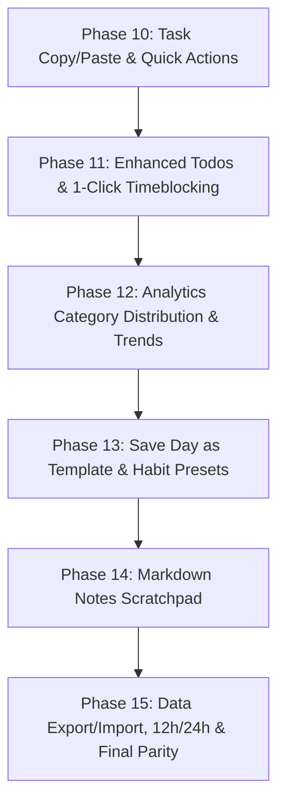

# DayFlow Web vs. Mobile Feature Parity Master Registry & Implementation Plan

**Date:** October 13, 2026  
**Reference Web App:** DayFlow Web v2.9.0 (`c:\githubrepo\myrepos\DayFlow`, 10,400+ LOC)  
**Target Mobile App:** DayFlow Android (`c:\githubrepo\myrepos\DayFlow-Mobile`, 12,000+ LOC)  

---

## 1. Executive Summary

This document serves as the **definitive, exhaustive tracking registry** for achieving 100% feature parity between DayFlow Web and DayFlow Mobile. Every feature in the Web codebase has been inventoried across all modules (`grid.js`, `notes.js`, `habits.js`, `analytics.js`, `settings.js`, `modal.js`, `notifications.js`).

Mobile development has already established a production-grade foundation (Room v4 offline sync, Biometric security, 48-slot Golden Time-Lock schedule engine, dynamic category manager, Day Templates, multi-slot bulk actions). This registry catalogs all remaining capabilities required to achieve full parity.

---

## 2. Complete Parity Gap Inventory by Functional Area

### Area 1: 30-Minute Schedule Timeline & Slot Actions (`grid.js`, `modal.js`, `app.js`)

| # | Feature Name | Web App Implementation | Mobile Status | Work Required |
|---|---|---|---|---|
| 1.1 | **48 Half-Hour Grid** | 00:00 to 23:30 slots, 12h/24h labels | ✅ Implemented | Complete. |
| 1.2 | **Golden Time-Lock Rule** | Future=Plan only; Past=Actual+Status+Duration | ✅ Implemented | Complete in `SaveSlotUseCase`. |
| 1.3 | **Slot Status Workflow** | Pending, Done, Partial, Missed transitions | ✅ Implemented | Complete. |
| 1.4 | **Custom Categories** | Dynamic colors, emojis, productive flag | ✅ Implemented | Complete with Room entity & sync. |
| 1.5 | **Multi-Slot Selection** | Checkbox selection mode, floating bulk bar | ✅ Implemented | Complete. |
| 1.6 | **Task Copy & Paste** | Single & bulk paste, Golden Time-Lock adaptation | 🟡 In Review | Implemented in ViewModel & BottomSheet; pending final verification & commit. |
| 1.7 | **Duplicate Next Slot** | `Ctrl+D` instant clone to next 30-min block | 🟡 In Review | Added to BottomSheet; pending commit. |
| 1.8 | **Timeline Category Filter** | Dropdown/pill filter to view slots for specific category | ❌ Missing | Add horizontal category chip filter bar above timeline. |
| 1.9 | **Dynamic "NOW" Indicator** | 10-sec ticker highlighting current active slot with "+ Log current task" prompt | ❌ Missing | Add live "📍 NOW" pulsing badge on current slot with quick-log prompt. |
| 1.10 | **Configurable Timeline Window** | Start hour & End hour windowing (e.g. 06:00 to 22:00 vs 24h) | ❌ Missing | Settings option to filter displayed timeline hours. |
| 1.11 | **Undo Action Buffer** | Floating toast with 5-sec Undo after slot delete/bulk clear | ❌ Missing | In-memory undo stack for slot deletions. |

---

### Area 2: Todos & Timeblocking Engine (`notes.js`)

| # | Feature Name | Web App Implementation | Mobile Status | Work Required |
|---|---|---|---|---|
| 2.1 | **Weekly Todos Checklist** | Add, toggle done, delete, Room/API sync | ✅ Implemented | Basic checklist complete. |
| 2.2 | **Priority Badges** | High (🔴), Medium (🟡), Low (🟢) with color chips | ❌ Missing | Add `priority` field to `TodoEntity` / `Todo`, selector in dialog, colored badges. |
| 2.3 | **Focus Category Tagging** | Assign category to Todo with category color dot | ❌ Missing | Add `category` field to `Todo`, category picker in Todo dialog. |
| 2.4 | **Dynamic Filter Pills** | Horizontal bar: `All` \| `High` \| `Medium` \| `Low` \| `Pending` \| `Done` | ❌ Missing | Add filter chips row above Todo list in `TodosScreen.kt`. |
| 2.5 | **1-Click "Schedule to Grid"** | Timeblock todo directly to a timeline slot | ❌ Missing | "Schedule" action button on todo item opening timeblock dialog. |
| 2.6 | **Slot Conflict Detection** | Warning dialog if target slot already has a planned/actual task | ❌ Missing | Conflict check in `ScheduleTodoUseCase`; prompt user to Overwrite or pick another slot. |
| 2.7 | **Auto-Find Next Free Slot** | Button to automatically find the next unoccupied 30-min slot | ❌ Missing | Algorithm to scan timeline forward from preferred time and select first empty slot. |
| 2.8 | **Cascade Deletion Options** | Prompt to "Clear scheduled slots" or "Keep slots" when deleting a scheduled Todo | ❌ Missing | Check linked slots on delete and prompt user. |

---

### Area 3: Notes & Markdown Scratchpad (`notes.js`, `markdown.js`)

| # | Feature Name | Web App Implementation | Mobile Status | Work Required |
|---|---|---|---|---|
| 3.1 | **Daily/Weekly Notes Editor** | Markdown notes area linked to selected week/day | ❌ Missing | Add Notes tab or BottomSheet with text editor. |
| 3.2 | **Multi-Sheet Notes Tabs** | Multiple sheets (e.g., Daily Log, Ideas, Retrospective) | ❌ Missing | Tabbed sheet manager per week. |
| 3.3 | **Markdown Preview / Formatting**| Headers, bullet points, checklists, bold/italic | ❌ Missing | Markdown rendering in Compose using annotated strings. |
| 3.4 | **Offline Autosave with Sync** | Debounced local save with sync in-flight indicator | ❌ Missing | Room entity `NoteEntity` with auto-save debounce. |

---

### Area 4: Habits Ledger & Gamification (`habits.js`)

| # | Feature Name | Web App Implementation | Mobile Status | Work Required |
|---|---|---|---|---|
| 4.1 | **Daily Habits Checklist** | Habit item with checkbox and streak count | ✅ Implemented | Dedicated Habits tab. |
| 4.2 | **Habit Action Ledger & Points** | Points system (+5, +10, +15 pts per action), points ledger log | ❌ Missing | Habit points calculation and logged history entries. |
| 4.3 | **Customizable Habit Presets** | Add, edit, archive presets with emoji, name, and pts | ❌ Missing | "Manage Habit Presets" dialog with custom emoji & point target. |
| 4.4 | **7-Day Consistency Matrix** | Mon–Sun completion grid showing weekly habit execution | ❌ Missing | 7-day mini dot/checkbox matrix in Habit card. |
| 4.5 | **Gamification Targets** | Daily points goal (e.g. 50 pts target) with progress bar | ❌ Missing | Daily goal setting and visual progress gauge. |
| 4.6 | **Points Breakdown Modal** | Modal showing exact points earned from habits + todos | ❌ Missing | Points inspection sheet. |

---

### Area 5: Productivity Analytics & Insights (`analytics.js`)

| # | Feature Name | Web App Implementation | Mobile Status | Work Required |
|---|---|---|---|---|
| 5.1 | **Core Daily KPIs** | Planned vs Actual hours, Focus Score %, Effectiveness % | ✅ Implemented | Present on schedule header card. |
| 5.2 | **Category Distribution Bars** | Visual breakdown (% and hours) by category | ❌ Missing | Analytics card with colored progress bars for Work, Learning, Health, etc. |
| 5.3 | **7-Day Consistency Trend** | Daily performance consistency bar chart across Mon–Sun | ❌ Missing | 7-day bar chart showing productivity score per day. |
| 5.4 | **View Mode Aggregation** | Toggle KPI between Day View and 7-Day Weekly Summary | ❌ Missing | Day vs Week toggle in Analytics card/screen. |

---

### Area 6: Templates Management (`settings.js`, `app.js`)

| # | Feature Name | Web App Implementation | Mobile Status | Work Required |
|---|---|---|---|---|
| 6.1 | **Apply Built-in Day Templates**| Productive Workday, Weekend Reset with Least Priority Rule | ✅ Implemented | Template bottom sheet with preview & apply. |
| 6.2 | **Save Current Day as Template**| Button to capture today's 48 slots as a new reusable template | ❌ Missing | "Save Current Day as Template" dialog in Template sheet. |
| 6.3 | **Custom Template Management** | Create, edit, rename, delete custom templates | ❌ Missing | Template CRUD manager in Settings. |

---

### Area 7: Settings, Data Backup & Account Security (`settings.js`, `apiClient.js`)

| # | Feature Name | Web App Implementation | Mobile Status | Work Required |
|---|---|---|---|---|
| 7.1 | **Category Customization** | Create, edit color/emoji, productive toggle | ✅ Implemented | SettingsBottomSheet. |
| 7.2 | **Notification Controls** | Quiet hours, active window, weekend mute | ✅ Implemented | SettingsBottomSheet. |
| 7.3 | **12h vs 24h Time Format** | Toggle between 12-hour AM/PM and 24-hour military time | ❌ Missing | Setting in SettingsBottomSheet + dynamic slot labels. |
| 7.4 | **1-Click JSON Data Export** | Export full schedule, habits, todos, and settings as JSON | ❌ Missing | "Export All Data (JSON)" using Android Storage Access Framework. |
| 7.5 | **JSON Data Import / Restore** | Import previously exported JSON backup | ❌ Missing | JSON file picker & parser with validation. |
| 7.6 | **Account Password Change** | Change password dialog communicating with auth endpoint | ❌ Missing | "Change Password" section in Settings. |

---

## 3. Sequenced Roadmap to 100% Full Parity

To deliver all missing functionalities safely, predictably, and with zero regression, work is structured into the following phases:

### Phase 10: Task Copy & Paste Parity (In Progress / Complete)
- **10.1** Slot clipboard in `ScheduleViewModel`: single copy, paste, bulk paste, clear.
- **10.2** Golden Time-Lock adaptation on paste (past retains actual task/status/duration; future resets to planned baseline, pending status, 0 duration).
- **10.3** "Duplicate Next Slot" action (`Ctrl+D` equivalent) for 1-tap cloning.
- **10.4** UI buttons: In `TaskEditorBottomSheet`, floating bulk action bar, and 1-tap `📥 Paste` on empty slot rows.
- **10.5** Verification: Unit tests pass (`CopyPasteSlotActionsTest`) and emulator verified.

### Phase 11: Enhanced Weekly Todos & 1-Click Timeblocking
- **11.1** Schema & Entity Update: Add `priority` (`HIGH`, `MEDIUM`, `LOW`) and `category` to `TodoEntity` / `Todo`.
- **11.2** Filter Bar: Horizontal filter pills (`All`, `High`, `Med`, `Low`, `Pending`, `Done`).
- **11.3** 1-Click "Schedule to Grid": Dialog to pick target day and 30-min slot.
- **11.4** Conflict Detection: Warning modal if slot is occupied, with "Auto-Find Next Free Slot" helper.
- **11.5** Deletion Cascade: Option to clear or keep scheduled slots when todo is deleted.

### Phase 12: Productivity Analytics & Visual Trends
- **12.1** Category Distribution: Card displaying percentage and hours breakdown per category with color bars.
- **12.2** 7-Day Consistency Trend: Bar chart visualizer showing daily productivity across the week.
- **12.3** Day vs. Week KPI aggregation toggle.

### Phase 13: "Save Day as Template" & Habit Presets Manager
- **13.1** "Save Current Day as Template" bottom sheet: capture current planned slots, name template, and store in Room.
- **13.2** Habit Presets Manager: Add, edit, archive habits, customize target points, and emoji picker.
- **13.3** 7-Day Habit Consistency Matrix: Mon–Sun visual completion dots per habit.

### Phase 14: Daily Notes & Markdown Scratchpad
- **14.1** Room entity `NoteEntity` with weekKey and dateKey.
- **14.2** Markdown scratchpad sheet with live rendered preview.
- **14.3** Tabbed notes (Daily Notes vs Weekly Retrospective).

### Phase 15: Settings, Data Backup & Account Security
- **15.1** 12-Hour vs 24-Hour military time format toggle.
- **15.2** JSON Data Export & Import via Android Storage Access Framework.
- **15.3** Change Password dialog in Settings.
- **15.4** Timeline windowing (custom start/end hour).
- **15.5** Dynamic "NOW" pulsing indicator on current 30-minute slot.

---

## 4. Parity Status Dashboard

| Functional Area | Total Web Features | Completed Mobile | In Progress | Missing | Parity % |
|---|:---:|:---:|:---:|:---:|:---:|
| **1. Schedule Timeline & Slot Actions** | 11 | 7 | 2 | 2 | **73%** |
| **2. Todos & Timeblocking** | 8 | 1 | 0 | 7 | **12.5%** |
| **3. Notes & Markdown** | 4 | 0 | 0 | 4 | **0%** |
| **4. Habits Ledger & Gamification** | 6 | 1 | 0 | 5 | **17%** |
| **5. Productivity Analytics** | 4 | 1 | 0 | 3 | **25%** |
| **6. Day Templates** | 3 | 1 | 0 | 2 | **33%** |
| **7. Settings, Backup & Security** | 6 | 2 | 0 | 4 | **33%** |
| **TOTAL** | **42** | **12** | **2** | **28** | **33%** |
